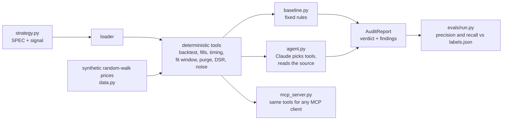

# Quant Research Agent

[](https://github.com/Avinash186200/quant-research-agent/actions/workflows/ci.yml)  [](LICENSE)

An agent that audits trading strategies for **look-ahead bias** and **selection bias**.

You hand it a strategy file. It runs deterministic checks (perturb future bars, compare same-bar and next-bar fills, perturb only the test period and see if fitted parameters move, deflate the Sharpe for the number of trials, run the strategy on a pure random walk) and returns a structured audit report: a verdict, and each finding with its bias type, the evidence behind it, and a fix.

I built this because the bugs that make a backtest look great are almost always the same handful, and they are cheap to test for mechanically. What is not cheap is reading the code and deciding which test matters. So the tools do the maths, and Claude does the reading and the judgement.

## What problem this solves

Most backtests that look too good have one of a few bugs: they trade on a price they could not have known yet, or
they report the best of many tries as if it were the only one. These bugs are easy to miss by reading code and easy
to catch by running small experiments on the strategy. This repo packages those experiments as tools, and lets an
agent decide which ones to run and explain what it found.

## At a glance

| | |
|---|---|
| **Input** | A Python strategy module exposing `signals(prices, **params)` (plus optional parameter grid, fit and label hooks) |
| **Method** | Deterministic, tested bias checks on seeded synthetic prices, exposed over MCP and to a Claude agent that chooses which to run and interprets the evidence |
| **Output** | JSON `AuditReport`: verdict, findings (bias type, evidence, fix), plus the tool calls and token usage behind it |
| **Guardrails** | Tools bound to one strategy, schema-enforced output, tool-call budget, refusal and max_tokens handled as inconclusive, no API calls in CI |
| **Status** | Working. Deterministic baseline measured below; agent numbers are yours to produce with your own key |

## How it works



1. **Load** a strategy module. It declares when it decides (open or close) and how it fills (same bar or next).
2. **Generate** a seeded random walk. No strategy has a real edge on it, so a big edge is a sign of a bug.
3. **Run checks** that change part of the data and watch what moves: future bars, the decision bar, the test period.
4. **Deflate** the reported Sharpe for the number of parameter settings that were tried.
5. **Report**: each fired check becomes a finding with its bias type, evidence and fix. The baseline does this with
   fixed rules; the agent chooses the checks and reads the code.
6. **Score** the reports against the known planted bugs.

| Bias type | How the tools catch it |
|---|---|
| `same_bar_fill` | Return collapses when the fill moves from bar t to bar t+1 |
| `current_bar_window` | Signals meant to be decided at the open change when the current bar is perturbed |
| `future_leak` | Past signals change when only future bars are perturbed |
| `test_fitted_threshold` | Fitted parameters move when only the test period is perturbed |
| `best_of_n` | Deflated Sharpe given the number of trials |
| `label_overlap` | Label horizon longer than the purge / embargo gap |

Exactly how each check works is in [docs/methodology.md](docs/methodology.md), and a tool-by-tool run on three
strategies is in [docs/walkthrough.md](docs/walkthrough.md). More detail, including why MCP, guardrails, cost control and failure modes, is in [docs/architecture.md](docs/architecture.md).

## Key concepts

- **Look-ahead bias**: the backtest uses information that was not available when the trade was decided.
- **Same-bar fill**: a signal computed from bar t's close is credited with bar t's own return. In real life you can
  only trade after you see the close.
- **Future leak**: a signal at time t depends on bars after t, for example a centred moving average.
- **Test-fitted parameter**: a threshold or setting fitted on data that includes the test period.
- **Selection bias (best of N)**: many settings were tried and only the best is reported, so its Sharpe is too high.
- **Probabilistic Sharpe ratio (PSR)**: the probability that the true Sharpe is above a benchmark, given the sample
  length, skew and fat tails.
- **Deflated Sharpe ratio (DSR)**: PSR where the benchmark is the Sharpe the best of N useless strategies would
  reach by luck.
- **Label overlap, purge and embargo**: a training label that covers days in the test fold leaks the answer.
  Purging drops those rows; an embargo adds a gap after the fold.
- **Perturbation test**: change only some of the data and check what moves. If past signals move when only future
  bars change, the strategy reads the future.
- **Noise test**: run the strategy on many random walks. An honest strategy averages a Sharpe near zero.
- **MCP (Model Context Protocol)**: a standard way to expose tools to any AI client over stdio.
- **Precision and recall**: of the biases flagged, how many were real; of the real biases, how many were flagged.

## What you will learn

- The handful of backtest bugs that cause most "too good" results, and a mechanical test for each.
- How to compute the probabilistic and deflated Sharpe ratio.
- How to design an agent so every number comes from a tested tool and the model only reads and judges.
- How to serve the same tools to any client with an MCP server.
- How to evaluate an auditor with planted bugs, ground-truth labels, precision and recall.
- Where a rule-based auditor stops, and what an agent has to add.

## Results: deterministic baseline

All results here come from the strategy corpus in this repo, run on **synthetic** random-walk prices. They measure
the auditor, not any strategy's real performance.

`python evals/run.py` on the 13-strategy corpus in `strategies/` (5 clean, 8 with planted bugs, ground truth in `strategies/labels.json`), seed 0:

**Precision 1.00 | Recall 0.78 | Verdict accuracy 0.92**

| Bias type | TP | FP | FN | Precision | Recall |
|---|---|---|---|---|---|
| same_bar_fill | 2 | 0 | 0 | 1.00 | 1.00 |
| current_bar_window | 1 | 0 | 0 | 1.00 | 1.00 |
| future_leak | 1 | 0 | 0 | 1.00 | 1.00 |
| test_fitted_threshold | 1 | 0 | 0 | 1.00 | 1.00 |
| best_of_n | 1 | 0 | 2 | 1.00 | 0.33 |
| label_overlap | 1 | 0 | 0 | 1.00 | 1.00 |

The baseline misses `best_of_n` twice. `tuned_mean_reversion` hard-codes parameters that were picked from a search, and in `sweep_same_bar` the sweep sits behind a bigger same-bar bug. A fixed rule cannot see either. That gap is what the agent is for: it reads the source and can call `deflated_sharpe` with the trial count it infers.

### Agent numbers

I do not publish agent numbers here, because I only report what I have measured. To produce them:

```bash
export ANTHROPIC_API_KEY=<your key>
python evals/run.py --agent --effort high
```

This writes `evals/results/agent.json` (every report, tool call and token count) and adds an agent table to `evals/results/results.md`. Without a key the flag is skipped.

## Quick start

```bash
pip install -r requirements.txt
python -m pytest -q      # fast and offline; the agent loop runs against a mocked client
python evals/run.py      # deterministic baseline
```

Serve the tools to any MCP client over stdio:

```bash
pip install -e .
qra-mcp
```

## Repo layout

```
src/qra/tools/         deterministic checks, backtest, strategy loader, PSR / DSR, tool registry
src/qra/agent.py       Claude agent: manual tool loop, adaptive thinking, structured output
src/qra/mcp_server.py  FastMCP server exposing the same tools
src/qra/baseline.py    rule-based auditor (the floor the agent must beat)
src/qra/data.py        seeded synthetic random-walk prices
src/qra/report.py      AuditReport and Finding schemas
src/qra/scoring.py     precision / recall against ground truth
strategies/            13 example strategies + labels.json
evals/run.py           runs the eval; results in evals/results/
tests/                 tools, eval, MCP server and agent loop (mocked client)
docs/                  README.md (index) · architecture.md · methodology.md · walkthrough.md
```

## Limits

- Everything runs on synthetic prices. Biases that only show up on real data (survivorship, corporate actions, stale quotes) are out of scope.
- The corpus is small and I wrote both the bugs and the checks, so the baseline is a sanity check, not a benchmark.

## License

MIT

See [CONTRIBUTING.md](CONTRIBUTING.md) and the [CHANGELOG](CHANGELOG.md).
